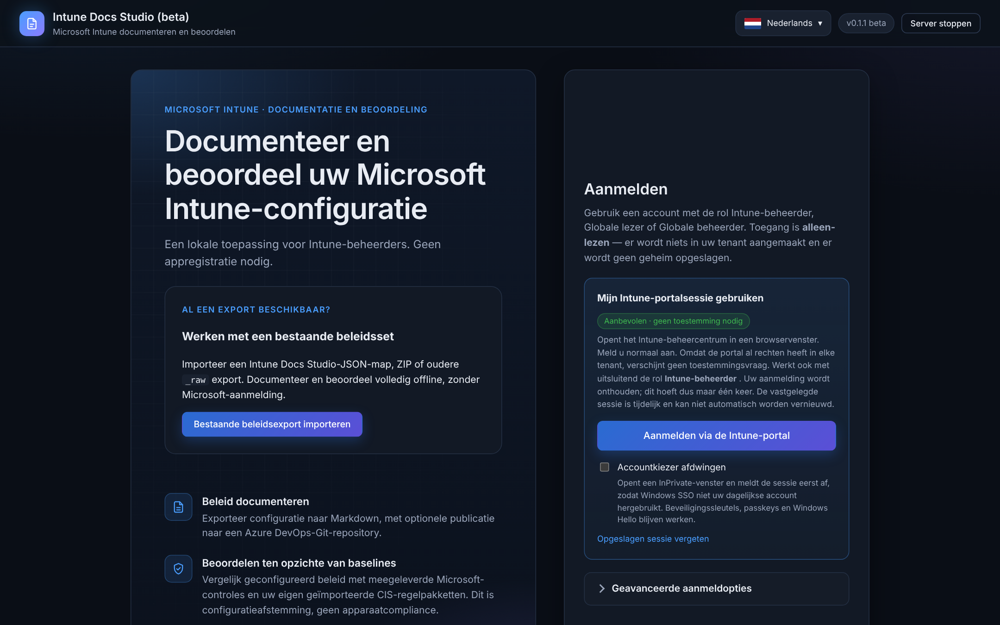
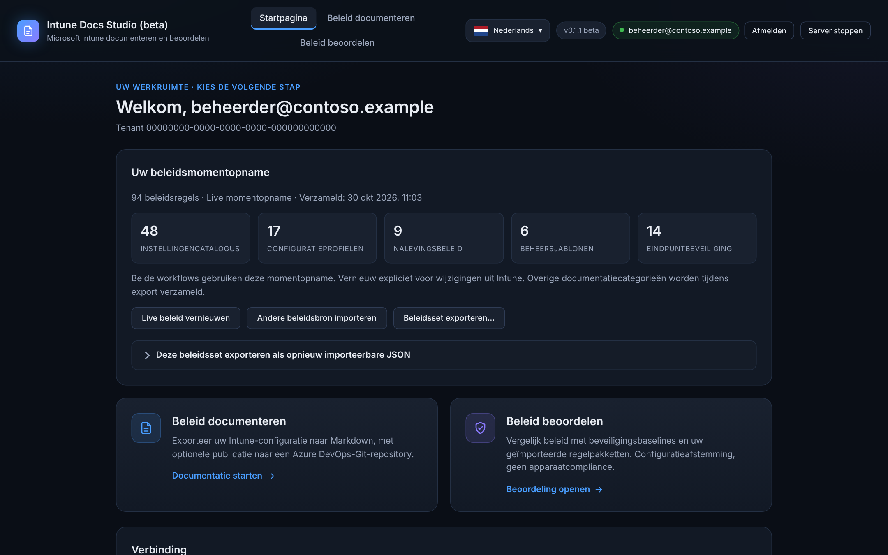
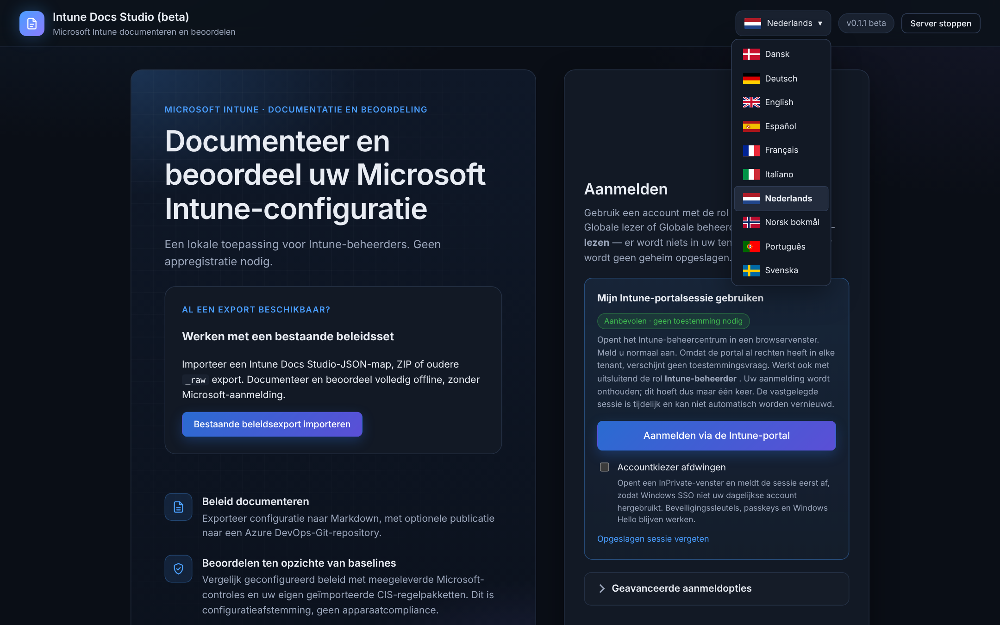
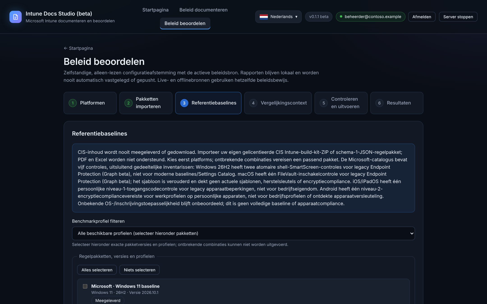
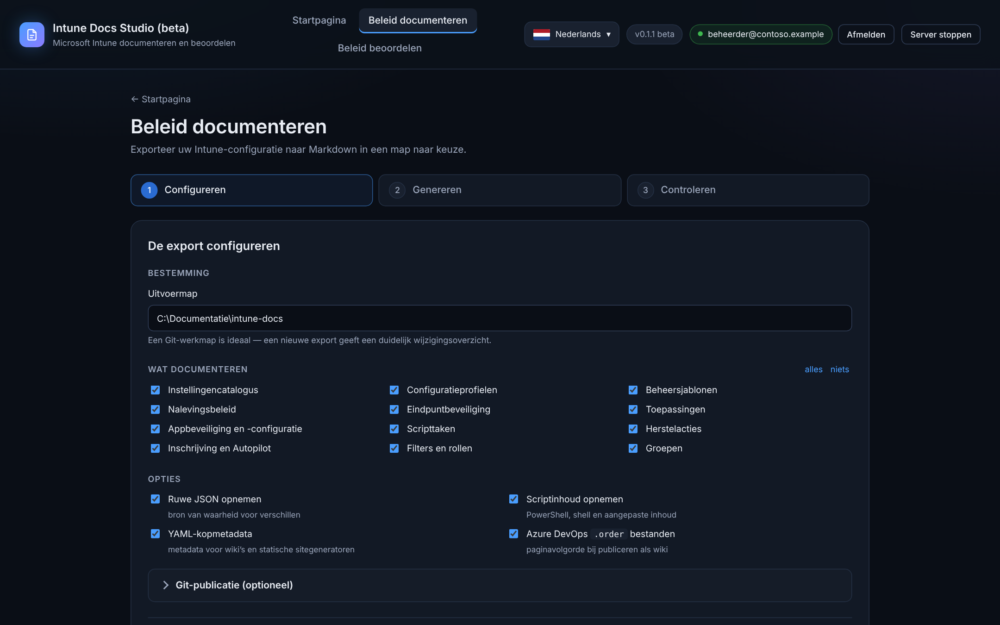

<div align="center">

# Intune Docs Studio

### Uw Intune-tenant. Eindelijk een open boek.

Maak van complexe configuraties heldere, gestructureerde documentatie.<br>
Van uw tenant naar een Git-klare Markdown-repository — zonder nieuwe app-registratie.

**Windows** &nbsp; / &nbsp; **PowerShell 7+** &nbsp; / &nbsp; **Lokaal eerst** &nbsp; / &nbsp; **Beta**

[**Download de beta-build →**](https://github.com/helmerzNL/intune-docs-studio/actions/workflows/beta.yml) &nbsp; · &nbsp;
[Snelstart](#snelstart) &nbsp; · &nbsp;
[Bekijk de uitvoer](#uitvoerstructuur) &nbsp; · &nbsp;
[Installatiegids](QUICKSTART.md)

*Dit is de Nederlandse vertaling van de [Engelse README](README.md). Bij verschillen is de Engelse versie leidend.
De gids [QUICKSTART.md](QUICKSTART.md) en de documenten in `docs/` zijn alleen in het Engels beschikbaar.*

</div>

---

## Minder documenteren. Meer begrijpen.

Voor beoordelingen, overdrachten en het moment waarop iemand vraagt: **„Hoe is dit eigenlijk geconfigureerd?”**

| Geen nieuwe app. Geen nieuw geheim. | De details, aan elkaar gekoppeld. | Een geschiedenis die u kunt lezen. |
|---|---|---|
| Gebruik een bestaande aanmeldmethode met alleen-lezentoegang. Geen nieuwe Entra ID-app-registratie of clientgeheim dat u moet roteren. | Documenteer beleid, apps, scripts en inschrijving, met opgeloste toewijzingsgroepen en filterregels naast de instellingen. | Exporteer Markdown naar uw Git-werkmap. Voer opnieuw uit, bekijk het verschil en publiceer via uw eigen repository. |

Uw tenantconfiguratie blijft alleen-lezen. Uw documentatie komt in een uitvoermap naar keuze.
Git-publicatie is optioneel; behandel gegenereerde tenantdocumentatie als gevoelig.

> **Beta, geen productierelease.** Valideer beta-pakketten voordat u ze operationeel gebruikt.
> Beta-builds zijn beschikbaar als ZIP-artifacts van geslaagde
> [Beta-workflowruns](https://github.com/helmerzNL/intune-docs-studio/actions/workflows/beta.yml).
> Aanmelden bij GitHub en toegang tot deze privérepository zijn vereist.
> Een build die naar `main` is gepromoveerd is een stabiele release; de aanduiding *beta* verdwijnt dan uit de
> titelbalk en de naam van de app.

## Snelstart

**U hebt nodig:** Windows en [PowerShell 7 of hoger](#vereisten). Git is optioneel en alleen nodig om
vast te leggen en te pushen.

1. Open een geslaagde [Beta-workflowrun](https://github.com/helmerzNL/intune-docs-studio/actions/workflows/beta.yml)
   en download het ZIP-artifact. Pak het artifact uit en pak daarna het meegeleverde
   applicatiepakket `IntuneDocsStudio.zip` uit.
2. Dubbelklik in de uitgepakte applicatiemap op **`Start-IntuneDocs.cmd`**.
   Het dashboard opent op <http://localhost:7654>.
3. **Meld u aan** — eerst opent de aanmeldpagina. Kies **Aanmelden via de Intune-portal**, of open
   **Geavanceerde aanmeldopties** voor de andere methoden. Meld u aan als beheerder met toegang tot de
   Intune-onderdelen die u wilt documenteren.
4. **Kies een beleidsbron** — kies na het aanmelden **Beleid laden** of **Niet nu**. Als u weigert, opent de
   startpagina zonder iets te verzamelen; beide workflows blijven uitgeschakeld tot u beleid laadt of
   importeert. U kunt ook zonder aanmelden op de aanmeldpagina **Bestaande beleidsexport importeren**.
5. **Documenteer beleid** — kies uw uitvoermap en de te documenteren onderdelen, klik op
   **Documentatie genereren**, volg de voortgang live, bekijk de Markdown en leg desgewenst vast en push onder
   **Git-publicatie**.



Hebt u de broncode of een uitgepakt applicatiepakket al? Open PowerShell 7 in die map en voer uit:

```powershell
.\Start-IntuneDocs.cmd
```

| 01 · Aanmelden | 02 · Documenteren | 03 · Beoordelen |
|---|---|---|
| Uw tenant, uw aanmelding. Lees alleen wat uw account mag zien. | Kies de onderdelen en een uitvoermap die u zelf beheert, los van de applicatie. Voer opnieuw uit als er iets verandert en bekijk daarna het verschil. | Vergelijk geconfigureerd beleid met versiebeheerde regelpakketten. Alleen-lezen bewijs, geen nalevingsscore. |

> **Voordat u verbindt:** standaard gedelegeerd Graph-aanmelden vereist beheerderstoestemming.
> De optionele portalsessiemethode heeft andere beperkingen en is geen door Microsoft ondersteund
> integratiepatroon. Lees de [aanmeldrichtlijnen](#welke-aanmeldmethode-moet-de-klant-gebruiken)
> voordat u een methode kiest.

De listener is uitsluitend aan `localhost` gebonden en vereist geen verhoogde rechten. Gebruik **Server stoppen**
in het dashboard of druk op Ctrl+C in het consolevenster om de tool te stoppen.
Na Ctrl+C kan cmd.exe vragen *„Batch-bestand beëindigen (J/N)?”*; de server is dan al gestopt, dus beide
antwoorden zijn goed.

Voor een begeleide rondleiding, zie [QUICKSTART.md](QUICKSTART.md). Voor veilig bijwerken, controles van de
identiteit van de draaiende build en back-up/herstel van uitvoer, zie [de beheerdersgids](docs/operations.md).

### De startpagina

Na het aanmelden en laden van beleid toont de startpagina de actieve tenant, het tijdstip van verzamelen en het aantal
beleidsregels per familie. Beide workflows — documenteren en beoordelen — gebruiken dezelfde momentopname.



> De screenshots in deze README zijn gemaakt met de echte webinterface (Nederlandse taal) en **synthetische
> demogegevens**. Ze bevatten geen echte tenant, account of beleid.

## Talen

De taalkiezer in de koptekst is beschikbaar vóór en na het aanmelden. Meegeleverde SVG-vlaggen en
inheemse taalnamen identificeren Deens, Duits, Engels, Spaans, Frans, Italiaans, Nederlands,
Noors (Bokmål), Europees Portugees en Zweeds, alfabetisch gesorteerd op inheemse naam.
Bij het eerste bezoek gebruikt de app de browsertaal als die wordt ondersteund en is anders Engels de standaard;
een opgeslagen keuze in deze browser heeft voorrang. De keuze werkt met het toetsenbord en past het huidige
scherm ter plekke aan, zonder de beleidsbron, aanmelding, wizardinvoer, importwachtrij of actieve taak te wissen.



De gekozen taal geldt ook voor nieuw gestarte documentatie- en beoordelingstaken. Elke taak legt zijn taal vast
bij het starten: later van interfacetaal wisselen mengt geen talen in de gegenereerde uitvoer. Bestaande
opgeslagen bestanden worden niet herschreven door alleen van taal te wisselen. Technische JSON-sleutels,
identificatoren, getypeerde beleidswaarden, klantnamen, door Microsoft geleverde instellingslabels en
externe benchmark- of controleteksten blijven ongewijzigd. De eigen knoppen van het Windows-mapdialoogvenster
en de pagina's van de identiteitsprovider volgen de taal van het besturingssysteem of de provider; titels en
berichten van de app volgen de gekozen taal. Documentatie voor ontwikkelaars en ontwikkellogboeken worden niet
vertaald.

Geef voor exports vanaf de opdrachtregel expliciet een locale op, bijvoorbeeld
`.\IntuneDocsStudio.ps1 -Export -Locale fr-FR -OutputPath C:\IntuneDocs\example-fr`.
Headless exports gebruiken standaard `en-GB`; de browservoorkeur verandert dat niet.

Vertalingen en vlaggen worden met de applicatie meegeleverd; er zijn geen runtime-verzoeken aan een
vertaaldienst of CDN. Zie [de gebruiksnotities over taal](docs/operations.md#language-settings-and-output)
voor instellingen, uitvoer en grenzen bij probleemoplossing.

## Geconfigureerd beleid beoordelen

Na het laden of importeren van beleid vergelijkt het pad **Beleid beoordelen** alleen-lezen beleidsbewijs met
versiebeheerde Microsoft-regels en lokaal geïmporteerde klantpakketten. Het wijzigt Intune niet, bepaalt de
effectieve toewijzing niet, certificeert geen benchmark en meet geen apparaatcompliance.



Het dashboard laadt Settings Catalog, configuratieprofielen, nalevingsbeleid, administratieve sjablonen en
endpoint-security-intents in een tenantgebonden momentopname in het geheugen. De startpagina toont het tijdstip
van verzamelen en het aantal per familie. Beide workflows hergebruiken die momentopname zonder dat beleid
opnieuw te verzamelen; andere geselecteerde documentatieonderdelen en opzoekingen van referenties worden tijdens
de export verzameld. Gebruik **Live beleid vernieuwen** op de startpagina na wijzigingen in de tenant.
Vernieuwen en het vervangen van de bron wissen actieve beoordelingsresultaten, niet de opgeslagen rapporten.
Live momentopnamen worden gewist bij afmelden of wisselen van tenant. Geïmporteerde offlinebronnen blijven
onafhankelijk van het aanmelden en worden nooit stilzwijgend door livegegevens vervangen. Alle actieve
momentopnamen worden gewist bij afsluiten. De export via de opdrachtregel verzamelt nog steeds rechtstreeks.

### Offline beleidssets

De aanmeldpagina accepteert een JSON-map van Intune Docs Studio, dezelfde map als ZIP, of een oudere export met
bruikbare `_raw`-beleids-JSON. Exports met alleen Markdown en formaten van andere tools worden niet ondersteund.
De startpagina toont de actieve omgeving, bron, tijdstempels, aantallen per familie en volledigheid. Mislukte
imports laten de huidige bron ongewijzigd; het vervangen van een geladen bron vraagt om bevestiging.

**Beleidsset exporteren** schrijft een nieuwe, uniek benoemde JSON-submap en overschrijft nooit een bestaande
export. Het `policyset.json`-manifest (versie 1) bevat SHA-256-hashes van vijf `families/*.json`-bestanden en
`references.json`. Beschikbare instellingen, definities, sjablonen, toewijzingen, namen, oorspronkelijk
verzameltijdstip en volledigheid blijven bij opnieuw importeren behouden. Authenticatieobjecten, tokens, cookies,
browserprofielen en herkende geheime waarden worden uitgesloten of geredigeerd. Behandel de resterende
configuratie als gevoelige klantgegevens; dit is geen back-up van inloggegevens.

Beide workflows werken offline **zonder Graph- of authenticatieverzoeken**. Offlinedocumentatie ondersteunt
alleen de vijf beleidsfamilies; apps, scripts en andere live onderdelen zijn uitgeschakeld. Ontbrekende
instellingen en namen blijven expliciet onbekend. Onvolledige families behouden bestaande pagina's en
raw-bestanden en rechtvaardigen nooit opschonen; nieuw gedocumenteerd offlinebeleid toont zijn beperkingen.
Oudere `_raw`-inventarissen zijn altijd onvolledig en hun verzameldatum blijft onbekend.

Invoer is begrensd tot een ZIP van 32 MiB, 1.000 items, 500 JSON-bestanden, 10 MiB per JSON, 64 MiB JSON in
totaal en 64 JSON-niveaus (mapnesting: 16). Onveilige paden, koppelingen, duplicaten en ongeldige
manifesten of hashes worden geweigerd. **Map kiezen** opent een Windows-dialoogvenster op de
**applicatiehost**, geen uploadvenster; annuleren behoudt het vorige pad. Bewerkbare hostpaden blijven
beschikbaar als het dialoogvenster mislukt.

Als laden mislukt, gebruik dan **Beleid opnieuw laden** of meld u af en controleer uw toegang. Een gedeeltelijke
lading toont expliciete verzamelbeperkingen en staat beide workflows nog toe: de beoordeling behoudt onvolledig
bewijs als onvolledig, terwijl de documentatie onvolledige beleidsfamilies overslaat, hun eerdere pagina's en
raw-bestanden behoudt en het opschonen voor die run overslaat. Geweigerde of afgekapte leesacties worden niet
als verwijdering uitgelegd.

> **Er worden vandaag slechts vijf controles in vier gedeeltelijke Microsoft-pakketten meegeleverd.** Windows 11
> heeft twee Windows 26H2-**baseline**-controles voor shell-SmartScreen; macOS heeft één FileVault-**aanbeveling**.
> Beide koppelen alleen legacy Endpoint Protection-eigenschappen via **Graph beta**, niet het equivalente
> Settings Catalog of moderne endpoint-security-instellingen. Het macOS-sjabloon is verouderd voor het
> aanmaken van profielen. iOS/iPadOS heeft één aanbeveling voor een toegangscode die **alleen voor persoonlijke
> apparaten** geldt; Android Enterprise heeft één aanbeveling over een versleutelingsvereiste in het
> *nalevingsbeleid*, **alleen voor persoonlijke apparaten met werkprofiel**. Versleuteling vereisen is geen bewijs
> van apparaatversleuteling of -compliance. Geen van deze pakketten is een volledige baseline, volledige
> benchmarkbeoordeling of nalevingsscore. **Ontbrekend** betekent alleen afwezig of niet geconfigureerd binnen de
> volledig gelezen gekoppelde families en beleidstypen van de regel, **niet afwezig in de hele tenant**.

De beoordeling is een wizard van zes stappen: **Platformen**, **Pakketten importeren**, **Referentiebaselines**,
**Vergelijkingscontext**, **Controleren en uitvoeren** en **Resultaten**. **Volgende** controleert elke stap en
fouten verschijnen onder de stappenbalk.

1. Meld u aan, bevestig de tenant op de startpagina en open **Beleid beoordelen**. Selecteer bij
   **Platformen** minstens één doelplatform.
2. Druk op **Volgende** om **Pakketten importeren** te openen. Plaats meerdere bestanden of hostmappen in de
   wachtrij, verwijder ongewenste rijen met de prullenbakknop en klik op **Importeren**. Elk item toont
   de echte laad-, voltooiings- of foutstatus; onafhankelijke fouten laten eerdere successen intact. Lees de
   samenvatting Toegevoegd/Al aanwezig/Overgeslagen/Mislukt met uitklapbare redenen, of ga verder met bestaande
   pakketten uit de bibliotheek. Selecteer de gelicentieerde CIS Intune build-kit-ZIP die u bij CIS hebt gedownload
   (maximaal 32 MiB) of één gelicentieerd, gecontroleerd **schema-1-JSON**-regelpakket (maximaal 10 MiB) en
   klik op **Pakket importeren**. De build-kit-ZIP wordt in het geheugen gelezen en de Settings
   Catalog-beleidsregels worden lokale regelpakketten. De kaart toont pakketten, overgeslagen items met redenen en
   het aantal genegeerde bestanden. Geïmporteerde pakketten worden nooit automatisch geselecteerd. Een los
   JSON-bestand moet een schema-1-regelpakket zijn; Settings Catalog-JSON wordt geconverteerd uit een build-kit-ZIP
   of een uitgepakte build-kitmap, inclusief submappen. Geconverteerde pakketten krijgen het label CIS zonder dat
   de bron wordt geverifieerd, dus importeer alleen uw gelicentieerde download. De indeling van de build-kit is
   niet geverifieerd; lees de samenvatting van de defensieve converter. PDF's, Excel, XCCDF/OVAL, Group Policy en
   OMA-URI-inhoud worden niet ondersteund; CIS-inhoud wordt niet meegeleverd of gedownload. Zie de
   [importreferentie](docs/assessment-rule-packs.md) voor alle velden, ondersteunde operatoren, genoemde
   grenzen en conversieregels voor de build-kit-ZIP. Kies **Beleidsset als aangepaste referentie** om een
   *aparte referentie-export* te converteren naar ondersteunde getypeerde verwachte waarden; alleen een doel
   importeren maakt geen baseline. Niet-ondersteunde, onvolledige, geheime of tegenstrijdige instellingen worden
   overgeslagen. Aangepaste referenties worden nooit als CIS of gecertificeerd aangeduid.
3. Selecteer bij **Referentiebaselines** 1–64 exacte regelpakketversies of -profielen, met een toepasselijk pakket
   voor elk geselecteerd platform. Lees hun classificatie, gedeeltelijke dekking, bronrevisies en SHA-256-identiteiten.
   Profiellabels bevatten de baselineset en of de herkomst geïmporteerd of meegeleverd is. Technische details zijn
   uitklapbaar. Geïmporteerde bibliotheekpakketten kunnen na bevestiging worden verwijderd; meegeleverde
   pakketten en opgeslagen rapporten zijn beschermd.
4. Voer bij **Vergelijkingscontext** bekende OS-versies in (Windows gebruikt een buildversie zoals `10.0.22000`)
   en de Android-inschrijvingsmodus; alleen velden voor de geselecteerde platformen verschijnen. Selecteer
   iOS/iPadOS **Persoonlijk eigendom** alleen expliciet voor dat vergelijkingsbereik; eigendom staat standaard op
   **Onbekend**. Onbekende toepasselijkheid blijft **niet beoordeeld**. Dit is door de gebruiker gekozen
   vergelijkingscontext, geen ontdekte inventaris, geen eigendom en geen effectieve toewijzing. Een Windows
   11-build kan compatibele onbeperkte Windows-familieprofielen afbakenen; de echte opname- en
   uitsluitingsregels van het beleid blijven gelden. Niet-ondersteunde voorwaarden blokkeren. Als de Windows
   11-build leeg is, legt een niet-blokkerende waarschuwing uit dat Windows-beleid voor Windows 10 en hoger,
   zoals dat wat CIS build-kitpakketten controleren, **niet beoordeeld** blijft.
5. Controleer bij **Controleren en uitvoeren** de samenvatting. Kies een absolute
   **doelmap voor beoordelingsrapporten**, gescheiden van zowel de installatiemap als de
   documentatie-exportmappen, en klik dan op **Geselecteerd beleid beoordelen**. Er kan één export of
   beoordeling tegelijk draaien; wacht voordat u zich afmeldt, reset of stopt.
6. Lees bij **Resultaten** de samenvatting, filter het bewijs op status, bekijk het bewijs van beleid en
   toewijzingen, verzamelproblemen en redenen, en open de getoonde paden van `assessment.md` en
   `assessment.json`. Elke run maakt een nieuwe rapportsubmap. **Nieuwe beoordeling** keert terug naar
   **Platformen** en behoudt uw keuzes; het is uitgeschakeld terwijl een beoordeling draait.

**Beoordelingsdekking** gaat over beoordeelde, opgesomde controles, niet over de hele bronbenchmark.
**Configuratie-afstemming** gaat over afgestemde versus beoordeelde controles. Onbekend, handmatig,
niet-ondersteund of onvolledig bewijs is **niet beoordeeld**, geen geslaagd of ontbrekend resultaat. Niet-toegewezen
afgestemd beleid toont geen uitrol aan; mogelijke conflicten zijn verschillende geconfigureerde waarden, geen
bewezen overlap in toewijzing. Groepen, uitsluitingen en filters zijn bewijs, geen opgeloste effectieve
lidmaatschappen.

Beleidsinstellingen in het dashboard en de rapporten gebruiken de leesbare tabellen en samenvattingen
verwacht/geconfigureerd van de documentatieschrijver: namen van Settings Catalog-definities en -opties, legacy
eigenschapslabels met spaties, ADMX-labels en -statussen en namen van endpoint-security-instellingen. Exacte
identificatoren, getypeerde vergelijkingen en toewijzingsmetadata blijven beschikbaar als technisch bewijs.
Leesbare tabellen wijzigen de evaluatie niet en breiden ondersteunde koppelingen niet uit; onvolledig, geheim
of niet-ondersteund beleidsbewijs wordt met een expliciete opmerking uit die tabellen gehouden. Rapporten
ontvangen nooit de oorspronkelijke documentatielading.

Geïmporteerde bestanden blijven bestaan in `%LOCALAPPDATA%\IntuneDocsStudio\AssessmentPacks` over
applicatie-updates heen; pakketten die uit een build-kit-ZIP zijn gegenereerd, worden daar ook opgeslagen.
De build-kit-ZIP zelf wordt niet bewaard, dus bewaar uw gelicentieerde download. Actieve tenantresultaten worden
gewist bij het resetten van de sessie. Rapporten gaan alleen naar de door u gekozen rapportroot. Behandel
pakketten en rapporten als klantgegevens, gescheiden van exports en hun Git-geschiedenis. De beoordeling
uploadt geen gegevens en legt rapporten niet automatisch vast of pusht ze niet. Zie de
[beheerprocedures](docs/operations.md) voor back-up, bijwerken en foutafhandeling; maak nooit een back-up van
tokens of browserprofielen.

### Wegwijs

[Aanmelden en rechten](#welke-aanmeldmethode-moet-de-klant-gebruiken) ·
[Vereisten](#vereisten) ·
[Uitvoerstructuur](#uitvoerstructuur) ·
[Beleidsbeoordelingen](#geconfigureerd-beleid-beoordelen) ·
[Wijzigingen volgen](#het-nut-van-opnieuw-uitvoeren) ·
[Publiceren naar Azure DevOps](#publiceren-naar-azure-devops) ·
[Opdrachtregel](#zonder-toezicht--opdrachtregel) ·
[Beveiliging](#beveiligingsnotities) ·
[Probleemoplossing](#probleemoplossing)

---

## Waarom dit bestaat

De meeste Intune-documentatietools vragen de klant een applicatie te registreren, *applicatiemachtigingen* te
verlenen, een clientgeheim aan te maken en dat voor altijd te roteren. In veel tenants is dat een gesprek met
de change-advisory-board, en het laat een permanente inloggegeven achter.

Deze tool doet dat allemaal niet.

| | Oude aanpak | Intune Docs Studio |
|---|---|---|
| App-registratie | Vereist | **Geen** |
| Clientgeheim | Vereist, moet worden geroteerd | **Geen** |
| Type machtiging | Applicatie (tenantbreed) | Gedelegeerd (alleen de aangemelde beheerder) |
| Effectief bereik | Alles, altijd | Wat die beheerder mag lezen, met inachtneming van Intune RBAC |
| Audittrail | „de app deed het” | De genoemde beheerder deed het |

### Welke aanmeldmethode moet de klant gebruiken?

**De beslissende vraag is of iemand beheerderstoestemming kan verlenen.** Elke
`DeviceManagement*.Read.All`-scope is alleen voor beheerders — een gebruiker kan er nooit zelf toestemming voor
geven, en goedkeuren vereist **Globale beheerder, Beheerder van bevoorrechte rollen, Cloudtoepassingsbeheerder
of Toepassingsbeheerder**. Een account met *alleen* de rol Intune-beheerder kan dit niet goedkeuren, ook al
kan hetzelfde account al die objecten in de portal wel lezen.

| Methode | Toestemming nodig? | Het best voor |
|---|---|---|
| **Mijn Intune-portalsessie gebruiken** | **Nee** | Een Intune-beheerder zonder route naar toestemming. Beoordelingen en eenmalige overdrachten. |
| Aanmelden met browser | Ja, eenmalig | Het normale geval waarin een Globale beheerder kan goedkeuren. Het robuustst. |
| Apparaatcode | Ja, eenmalig | Servers, jumphosts, RDP-sessies zonder bruikbare browser. |
| Azure CLI-sessie | Meestal al toegestemd | Hosts met een bestaande `az login`. Goed voor geplande runs. |
| Graph PowerShell-sessie | Meestal al toegestemd | Hosts die al `Connect-MgGraph` gebruiken. |

#### Mijn Intune-portalsessie gebruiken — hoe het werkt

Het Intune-beheercentrum zelf heeft in elke tenant al toestemming. Deze methode opent een browser naar de portal,
laat de beheerder zich aanmelden zoals gewoonlijk en leest het Microsoft Graph-token dat de portal zelf
verkrijgt. Er wordt niets geregistreerd en er verschijnt geen nieuwe toekenning in de directory.

Praktische notities, met pijn en moeite geleerd:

- **Windows SSO is bewust uitgeschakeld** in dat venster. Zonder dit meldt Edge stilzwijgend aan met het
  werkaccount van de machine zelf, wat meestal een *andere tenant* is dan degene die u documenteert — en de
  export vindt dan niets. U wordt gevraagd een account te kiezen; kies de beheerder van de tenant die u
  documenteert.
- **Meldt de browser zich toch automatisch aan met het verkeerde account**, vink dan **Accountkiezer
  afdwingen** aan. Daarmee wordt de browsersessie eerst afgemeld en een InPrivate-venster geopend, zodat noch
  Windows SSO noch het browserprofiel uw dagelijkse account kan hergebruiken. Beveiligingssleutels, passkeys en
  Windows Hello blijven werken — WebAuthn is niet aan een browserprofiel gebonden. De afweging is dat de
  aanmelding niet wordt onthouden voor de volgende run.
- **De aanmelding wordt onthouden** in een profiel onder `%LOCALAPPDATA%\IntuneDocsStudio`, dus dit is een
  eenmalige stap. De browser wordt via CDP netjes gesloten zodat Chromium zijn cookies naar schijf schrijft, en
  sessieherstel staat aan zodat de aanmelding blijft bestaan, of u nu wel of niet op de vraag *Aangemeld
  blijven?* van Azure AD ingaat. Gebruik **Opgeslagen sessie vergeten** op de aanmeldpagina om van account te
  wisselen.
- **Het token kan niet worden vernieuwd** — het refresh-token blijft binnen de portal. De levensduur wordt door
  tenantbeleid bepaald en loopt sterk uiteen (een uur in sommige tenants, bijna een dag in andere); het dashboard
  toont de werkelijke vervaltijd. Bij het laden van live beleid wordt de Graph-aanmelding gecontroleerd; als het
  token niet meer geldig is, meldt u zich opnieuw aan. Gebruik voor terugkerend werk liever een methode hierboven
  die kan vernieuwen.
- Dit hangt af van het huidige gedrag van het beheercentrum en is geen door Microsoft ondersteund
  integratiepatroon. Uitstekend voor een beoordeling; niet geschikt als basis van een pipeline.

### Gevraagde machtigingen

Allemaal alleen-lezen. Het dashboard toont welke zijn verleend en wat er geraakt wordt als er een ontbreekt.

| Scope | Dekt |
|---|---|
| `DeviceManagementConfiguration.Read.All` | Configuratieprofielen, Settings Catalog, compliance, endpoint security |
| `DeviceManagementApps.Read.All` | Applicaties, app-beveiligings- en app-configuratiebeleid |
| `DeviceManagementServiceConfig.Read.All` | Inschrijving, Autopilot, ESP, voorwaarden |
| `DeviceManagementRBAC.Read.All` | Rollen en scopetags |
| `DeviceManagementManagedDevices.Read.All` | Apparaataantallen en herstelstatus |
| `Group.Read.All` | Toewijzingsgroep-id's omzetten naar namen |

Een gebruiker met **Intune-beheerder**, **Globale lezer** of **Globale beheerder** kan het uitvoeren.
Een alleen-lezen Intune-rol werkt ook — de export bevat dan gewoon wat die rol kan zien.

---

## Vereisten

- Windows met **PowerShell 7 of hoger** (`pwsh` in `PATH`). Windows PowerShell 5.1 wordt niet ondersteund.
- Een browser (behalve voor de apparaatcodemethode)
- `git` in `PATH` — alleen als u de optie vastleggen/pushen wilt gebruiken

Er zijn geen modules te installeren. `Microsoft.Graph.Authentication` is optioneel en wordt alleen gebruikt
voor de aanmeldmethode „Graph PowerShell-sessie”.

De launcher controleert PowerShell 7 voordat hij start; hij valt nooit terug op Windows PowerShell.
Ontbreekt PowerShell 7 of kan het niet draaien, dan stopt hij en toont installatie-instructies. Er wordt niets
automatisch geïnstalleerd of bijgewerkt.

```powershell
# PowerShell 7 installeren
winget install --id Microsoft.PowerShell --source winget

# Een bestaande installatie bijwerken
winget upgrade --id Microsoft.PowerShell --source winget
```

Is WinGet niet beschikbaar, gebruik dan de officiële download op <https://aka.ms/powershell-release>.
Open na de installatie uw terminal opnieuw zodat `pwsh` in `PATH` beschikbaar is. Gebruik voor directe runs vanaf
de opdrachtregel `pwsh -NoProfile -File .\IntuneDocsStudio.ps1` met de gewenste parameters; het script zelf
weigert versies ouder dan 7.

## Pakketidentiteit

Een broncode-checkout zonder `build-info.json` identificeert zichzelf als **beta / development**.
`Build-Package.ps1` maakt `IntuneDocsStudio.zip` uitsluitend van de productbestanden en voegt een
`build-info.json` toe met precies `version`, `channel` en `commit`. De ZIP-inhoud en tijdstempels worden
genormaliseerd, zodat herhaalde builds van ongewijzigde invoer byte-identiek zijn.

De titelbalk en de naam van de app tonen **(beta)** zolang het pakket kanaal `beta` heeft. Een pakket met kanaal
`stable` — gebouwd bij een promotie van `beta` naar `main` — toont die aanduiding niet.

Voor een lokaal ontwikkelpakket zijn beta/development de standaardwaarden:

```powershell
pwsh -NoProfile -File .\Build-Package.ps1 -OutputPath C:\release
```

Geef voor een pakket dat aan een bronrevisie is gekoppeld de volledige Git-SHA van 40 tekens (kleine letters) op:

```powershell
pwsh -NoProfile -File .\Build-Package.ps1 -OutputPath C:\release `
  -Channel beta -SourceCommit 0123456789abcdef0123456789abcdef01234567
```

Stabiele pakketten vereisen zowel `-Channel stable` als een expliciete volledige bron-SHA; een
ontwikkelidentiteit kan niet als stabiel worden gelabeld. Het pakket bevat de publicatiegids en bevat
`docs/operations.md` alleen als die gids bestaat. Instructies voor bijdragers en agents, tests, buildscripts,
workflows en ontwerpspecificaties worden nooit meegeleverd.

---

## Uitvoerstructuur

```
intune-docs/
├─ README.md                        tenant, aantallen, waarschuwingen
├─ index.md                         volledige inhoudsopgave
├─ .order                           paginavolgorde voor de Azure DevOps-wiki
├─ .gitattributes
├─ configuration/
│  ├─ settings-catalog/<platform>/*.md
│  ├─ templates/*.md
│  ├─ administrative-templates/*.md   ADMX, met categorie en status
│  └─ custom/*.md                     OMA-URI en aangepaste payloads
├─ compliance/<platform>/*.md         regels + acties bij niet-naleving
├─ endpoint-security/<categorie>/*.md
├─ apps/<platform>/*.md               installatie-, detectie- en vereisteregels
├─ app-management/
│  ├─ app-protection/<platform>/*.md
│  └─ app-configuration/*/*.md
├─ scripts/
│  ├─ windows/*.md  macos/*.md        scriptinhoud inline
│  └─ remediations/*.md               detectie- + herstelscripts
├─ enrollment/
│  ├─ autopilot/*.md  enrollment-status-page/*.md  restrictions/*.md
├─ assignments/
│  ├─ by-group.md                     elk object dat op elke groep is gericht
│  ├─ by-object.md                    opgenomen/uitgesloten groepen per object
│  └─ unassigned.md                   kandidaten om op te ruimen
├─ reference/
│  ├─ groups/*.md                     met lidmaatschapsregels en „gebruikt door”
│  ├─ filters/*.md
│  └─ roles/*.md                      alleen aangepaste rollen
└─ _raw/**/*.json                     genormaliseerde bronobjecten
```

Elke pagina heeft YAML-front matter (`intuneId`, `objectType`, `platform`, `lastModified`), een
overzichtstabel, de instellingen in leesbare vorm, de toewijzingen en het ruwe object in een
ingeklapt `<details>`-blok.

Gebruikt een toewijzing een toewijzingsfilter, dan wordt de **regel van het filter uitgeschreven onder de
toewijzingstabellen**, zodat u kunt zien welke apparaten daadwerkelijk worden bereikt zonder een andere pagina
te openen. Filterpagina's tonen op hun beurt elke toewijzing die ze gebruikt.



---

## Het nut van opnieuw uitvoeren

De export is **deterministisch**. Objectpagina's bevatten geen exporttijdstempel, JSON-sleutels zijn
gesorteerd en bestanden worden alleen herschreven als hun inhoud echt verandert. Een manifest legt vast wat
is geschreven, zodat in Intune verwijderde objecten bij de volgende run uit de repository worden opgeschoond.
Als er in de tenant niets is veranderd, wordt **niets geschreven en geen commit gemaakt** — de werkmap
blijft schoon en de geschiedenis groeit niet.

Dat betekent:

```
git diff
```

toont **precies wat er in Intune is veranderd** — en niets anders. Richt dit op een Git-werkmap, voer het
volgens een schema uit en de commitgeschiedenis wordt een audittrail van configuratiedrift.

Vink **Vastleggen in Git** aan in het dashboard, of schakel **Pushen naar remote** in om vast te leggen en te
pushen. Vanaf de opdrachtregel schakelt `-GitPush` ook het vastleggen in.

### Verzint nooit drift

Als een onderdeel niet kan worden verzameld — een throttle, een tijdelijke Graph-fout, een verbroken
verbinding — **slaat de exporter de opschoonstap helemaal over** en meldt dat. Pagina's verwijderen omdat een
aanroep toevallig mislukte, zou „dit beleid is verwijderd” in de geschiedenis schrijven terwijl er niets
dergelijks is gebeurd. Een verouderde pagina voor één run is een veel kleiner probleem dan een valse verwijdering
in een audittrail, dus onvolledige runs schonen nooit op.

Eindpunten die echt niet van toepassing zijn op een tenant (HTTP 400/403/404) worden stilzwijgend getolereerd;
tijdelijke fouten niet.

---

## Publiceren naar Azure DevOps

De boom heeft al de vorm van een wiki: elke map heeft een bijbehorende landingspagina en een `.order`-bestand.

1. Maak een Azure Repos Git-repository aan, of kies een bestaande documentatierepository.
2. Plak in het onderdeel **Git-publicatie** van het dashboard de **kloon-URL** en kies eventueel een
   **doelbranch**. Dit schakelt **Vastleggen in Git** en **Pushen naar remote** in.
3. Kies een **lege uitvoermap** voor de eerste kloon, of een bestaande schone checkout van dezelfde
   repository, en genereer dan documentatie.
4. Voltooi de aparte Azure DevOps-aanmelding via Git Credential Manager als daarom wordt gevraagd.
   SSH-kloon-URL's gebruiken uw geconfigureerde SSH-sleutel. Zet geen tokens in de URL.
5. Ga in Azure DevOps naar **Overzicht → Wiki → Code publiceren als wiki** en selecteer de repository,
   branch en map.

De exporter behoudt de bestaande repositorygeschiedenis, doet een fast-forward van een schone checkout voor de
export en configureert bij de eerste push de branch-tracking. Laat de branch leeg om bij de eerste kloon de
standaardbranch van de repository of bij een bestaande checkout de huidige branch te gebruiken; een lege
repository begint op `main`. Een nieuwe doelbranch begint vanaf de gekloonde standaardbranch. De tool vervangt
nooit een andere remote en forceert nooit een push; los lokale wijzigingen of afwijkende geschiedenis op voordat
u exporteert. Gegenereerde pagina's worden in de root van de repository geschreven, dus gebruik een
speciale documentatierepository.

Opnieuw exporteren en pushen werkt de wiki ter plekke bij. Zie
[`docs/publishing.md`](docs/publishing.md) voor voorbeelden met GitHub, MkDocs en pipelines.

---

## Zonder toezicht / opdrachtregel

```powershell
# Interactief aanmelden, daarna exporteren en vastleggen
.\IntuneDocsStudio.ps1 -Export -OutputPath C:\repos\intune-docs -GitCommit

# Headless host: aanmelden met apparaatcode
.\IntuneDocsStudio.ps1 -Export -Method devicecode -OutputPath C:\repos\intune-docs

# Een bestaande az login hergebruiken, alleen geselecteerde onderdelen, zonder scriptinhoud
.\IntuneDocsStudio.ps1 -Export -Method azurecli `
    -Sections settingsCatalog,compliance,apps -NoScriptContent
```

| Parameter | Doel |
|---|---|
| `-Export` | Headless uitvoeren, zonder dashboard |
| `-Method` | `interactive` (standaard), `browser`, `devicecode`, `azurecli`, `mggraph` |
| `-Client` | `graphcli` (standaard), `azurecli`, `intuneps` |
| `-Tenant` | Tenant-id of domein; standaard `organizations` |
| `-OutputPath` | Doelmap |
| `-Sections` | Subset van te documenteren onderdelen |
| `-GitCommit` / `-GitPush` | Het resultaat vastleggen en pushen |
| `-GitRemoteUrl` | Bestaande Azure DevOps HTTPS- of SSH-kloon-URL; gebruik met `-GitCommit` of `-GitPush` |
| `-GitBranch` | Doelbranch; standaard de standaard-/huidige branch van de remote, of `main` voor een lege remote |
| `-NoScriptContent` | Scriptinhoud en aangepaste payloads weglaten |
| `-NoRawJson` | De `_raw`-boom en de inline JSON-blokken weglaten |
| `-NoFrontMatter` | YAML-front matter weglaten |
| `-NoAdoOrder` | `.order`-bestanden weglaten |
| `-Port` | Dashboard- / loopback-redirectpoort (standaard 7654) |

Gedelegeerde tokens zijn kortlevend en bewust interactief, dus een volledig onbeheerde geplande run vereist de
apparaatcode- of Azure CLI-methode met een sessie die in leven wordt gehouden. Voor een echt onbeheerde pipeline
blijft een app-registratie het juiste gereedschap — dit project bestaat voor het veel vaker voorkomende geval
waarin die ongewenst is.

---

## Beveiligingsnotities

- Gegenereerde documentatie wordt naar de gekozen uitvoermap geschreven. Aanmelden via de portalsessie leest een
  token uit de MSAL-cache van de browser; het aparte profiel onder
  `%LOCALAPPDATA%\IntuneDocsStudio\browser-profile` kan cookies en ander in de cache bewaard
  authenticatiemateriaal bewaren.
- Door de app beheerde tokens en de normale dashboardstatus staan in het procesgeheugen; de app schrijft zijn
  tokenstatus niet naar schijf. Maak geen back-up van browserprofielen, kopieer of herstel ze niet als
  applicatiegegevens.
- Geheime waarden (`SecretSettingValue`, OMA-geheimverwijzingen) worden geëxporteerd als
  `«secret — not exported»`, nooit als platte tekst.
- **Scriptinhoud en aangepaste payloads worden standaard opgenomen**, omdat dat meestal de reden is om ze te
  documenteren. Ze kunnen gevoelig materiaal bevatten — haal het vinkje bij *Scriptinhoud opnemen* weg of geef
  `-NoScriptContent` mee als de doelrepository breed leesbaar is.
- De HTTP-listener is uitsluitend aan `localhost` gebonden.
- Beheerprocedures voor bijwerken, back-up en herstel staan in
  [`docs/operations.md`](docs/operations.md).

Kwetsbaarheden meldt u privé, zie [SECURITY.md](SECURITY.md); gebruik hiervoor geen openbare issues.

---

## Probleemoplossing

| Symptoom | Oorzaak en oplossing |
|---|---|
| „Beheerdersgoedkeuring vereist” bij de toestemmingsvraag | Uw account kan geen beheerderstoestemming verlenen. Gebruik **Mijn Intune-portalsessie gebruiken**, of laat een Globale beheerder het eenmalig goedkeuren. |
| Aanmeldvenster opent met het verkeerde account | Vink **Accountkiezer afdwingen** aan en meld u opnieuw aan. Dat opent een InPrivate-venster met de sessie afgemeld, zodat Windows SSO uw dagelijkse account niet kan hergebruiken. Passkeys en beveiligingssleutels blijven werken. |
| Portalsessie vraagt elke keer om aanmelding | Opgelost in de huidige build: de browser wordt nu netjes gesloten zodat Chromium zijn cookies naar schijf schrijft. Let op: **Accountkiezer afdwingen** onthoudt de sessie bewust niet. |
| Portalopname meldt „geen bruikbaar token” | Het account waarmee u zich aanmeldde heeft mogelijk geen Intune-rol in die tenant, of de aanmelding is nooit voltooid. De statusregel toont de gezien API-hosts. |
| Toewijzingen tonen `(deleted group …)` | Die toewijzingen richten zich op groepen die niet meer in Entra ID bestaan. Echte kandidaten om op te ruimen — zie `assignments/by-group.md`. |
| Toewijzingen tonen `(group … insufficient permission)` | De aanmelding mist `Group.Read.All`. Objectpagina's zijn volledig; alleen de *namen* van groepen ontbreken. |
| Sommige onderdelen zijn leeg en er verschijnt een waarschuwing | Het aangemelde account mist de bijbehorende scope of Intune RBAC. De machtigingenlijst van het dashboard toont welke. |
| `AADSTS50011` redirect-URI komt niet overeen | Er herschrijft iets de loopback-redirect. Gebruik de **apparaatcode**-methode. |
| Export is traag in een grote tenant | Normaal: instellingen worden per beleid in batches van 20 opgehaald. Latere runs melden bijna alles als *ongewijzigd*. |
| Poort 7654 is in gebruik | Start met `-Port 7655`. |
| PowerShell 7 ontbreekt of kan niet starten | Volg de installatie-/update-instructies van de launcher, open de terminal opnieuw en voer opnieuw uit. Windows PowerShell 5.1 kan de tool niet draaien. |
| `git push` mislukt | Voer een Azure DevOps-kloon-URL in of configureer een remote in de uitvoer-checkout. Controleer de Git-inloggegevens en de rechten op repository/branch. De lokale commit blijft behouden; voer opnieuw uit om de push opnieuw te proberen, ook als er niets is veranderd. |

---

<div align="center">

**Minder giswerk. Betere overdrachten.**

[Installatiegids](QUICKSTART.md) · [Publicatiegids](docs/publishing.md) ·
[Beheerdersgids](docs/operations.md) · [Beveiligingsbeleid](SECURITY.md)

Een onafhankelijk project. Niet verbonden aan of onderschreven door Microsoft.<br>
Microsoft Intune is een handelsmerk van Microsoft.

</div>
